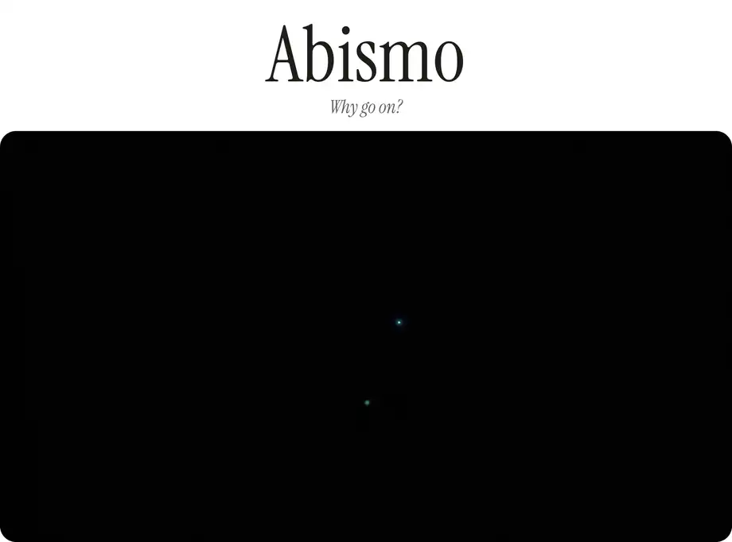
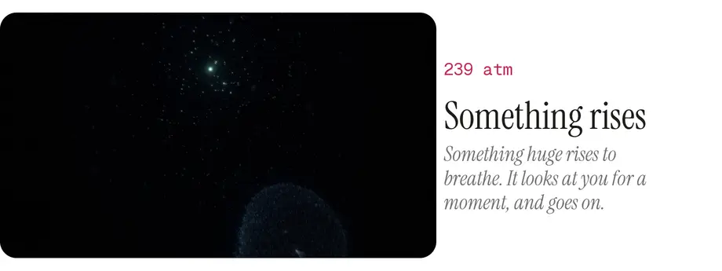
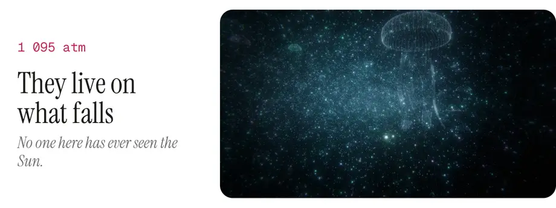
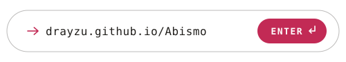

  <picture><source media="(prefers-color-scheme: dark)" type="image/avif" srcset="media/cover-dark.avif"><source media="(prefers-color-scheme: dark)" srcset="media/cover-dark.webp"><source type="image/avif" srcset="media/cover-light.avif"></picture>

  <picture><source media="(prefers-color-scheme: dark)" type="image/avif" srcset="media/whale-dark.avif"><source media="(prefers-color-scheme: dark)" srcset="media/whale-dark.webp"><source type="image/avif" srcset="media/whale-light.avif"></picture>

  <picture><source media="(prefers-color-scheme: dark)" type="image/avif" srcset="media/jelly-dark.avif"><source media="(prefers-color-scheme: dark)" srcset="media/jelly-dark.webp"><source type="image/avif" srcset="media/jelly-light.avif"></picture>

  <a href="https://drayzu.github.io/Abismo/"><picture><source media="(prefers-color-scheme: dark)" srcset="media/enter-dark.svg"></picture></a>

This piece talks about depression and suicide. If you are thinking about it, talk to someone today. <a href="https://findahelpline.com">findahelpline.com</a> · helplines in your country, free

 

How it's made

 

- The sixth piece of Horizontes (Espacio · Tiempo · Destino · Infinito · Mente · Abismo · Vida), the most personal one: one scroll down into the sea at night, and back up to the light.
- Everything is points: the snow that falls, a canyon only your light and the calls can reveal, a whale, a field of 320 000 sparks and the animals that light up when you move.
- It never starts or ends on its own: it asks first, and its last card waits.
- In Spanish for now. Key: `A` autoplay.
- TypeScript, Three.js and Vite, no framework. `npm install`, `npm run dev`; pushing to `main` deploys to GitHub Pages.

